<p align="center">
  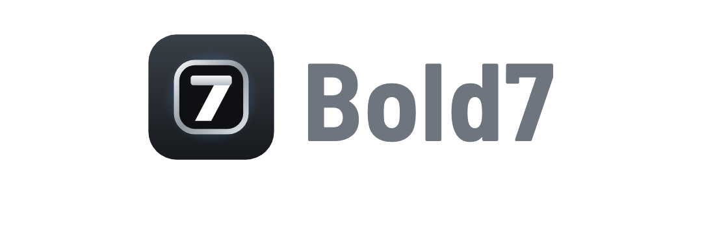
</p>

<p align="center">
  <strong>BlackBerry OS 7.1, rebuilt for the Zinwa Q25.</strong><br>
  Bold7 replaces the Android interface of the Q25 with the complete interface of the BlackBerry Bold 9900:
  home screen, status bar, apps, keyboard, lock screen, sounds and dialogs.
</p>

<p align="center">
  <a href="LICENSE"></a>
  
  
  
</p>

<p align="center">
  <a href="https://bold7-site.vercel.app"></a>
</p>

<p align="center">
  <a href="#features">Features</a> ·
  <a href="#install">Install</a> ·
  <a href="#performance">Performance</a> ·
  <a href="#for-developers">For developers</a> ·
  <a href="#legal">Legal</a>
</p>

> [!IMPORTANT]
> **Bold7 0.1, two lines, one interface.** Bold7 runs on the official **LineageOS 24** of the Q25 (Android 17, weekly security updates), the line developed first, on the `main` branch of this repository, and on **BenOS** (Android 14), on the [`benos`](https://github.com/codexofc/bold7/tree/benos) branch. 0.1 is the first public release: what still shows Android is listed in the [roadmap](ROADMAP.md). [Download](https://github.com/codexofc/bold7/releases)

---

<!-- MEDIA: demo video. GitHub does not play a video stored in the repository inline:
     either upload the video in the GitHub editor and paste the user-attachments URL on its own line,
     or keep this poster image linking to the hosted video. -->
<p align="center">
  <a href="https://bold7-site.vercel.app">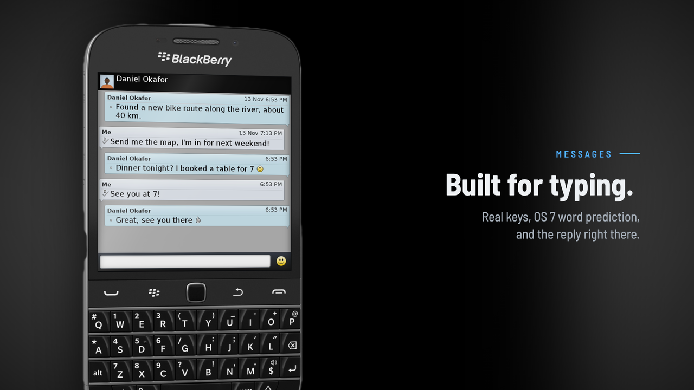</a>
</p>

## Screenshots

Captured on a Q25 at its native 720 x 720.

<!-- MEDIA: twelve 720 x 720 PNG captures in media/screens/. -->
<table>
  <tr>
    <td align="center">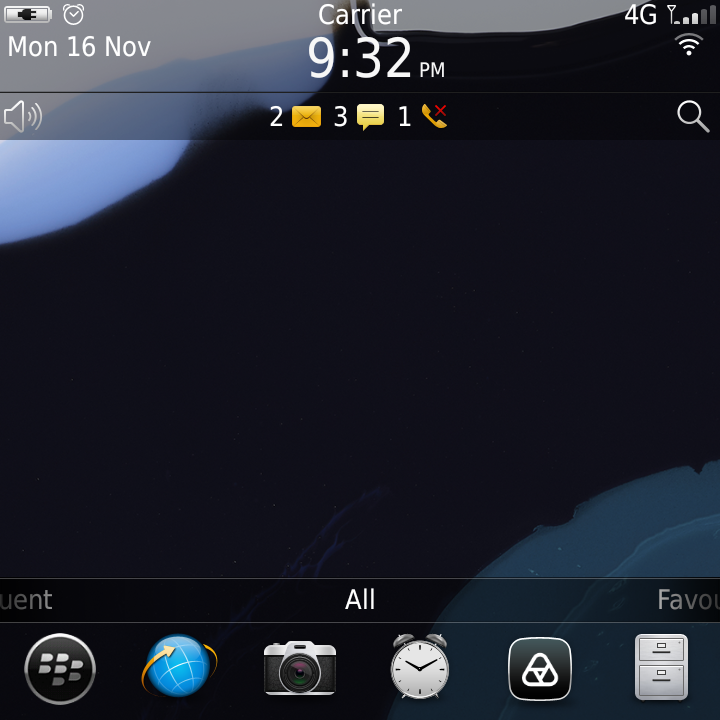<br><sub>Home screen</sub></td>
    <td align="center">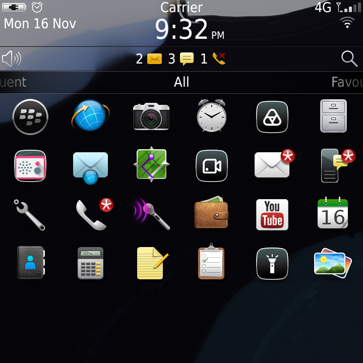<br><sub>App drawer</sub></td>
    <td align="center">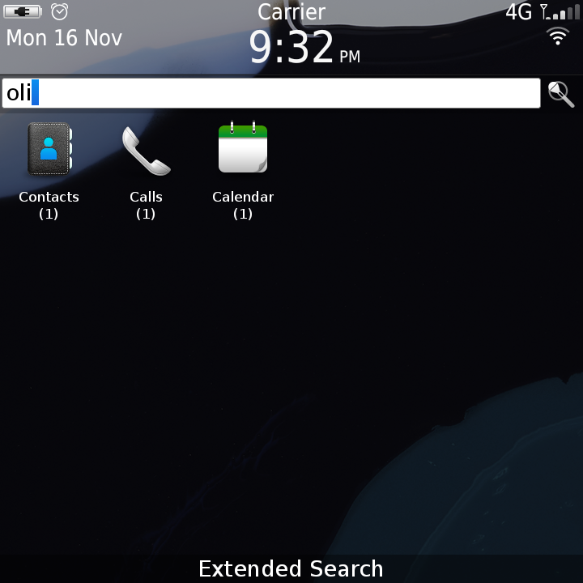<br><sub>Universal search</sub></td>
  </tr>
  <tr>
    <td align="center">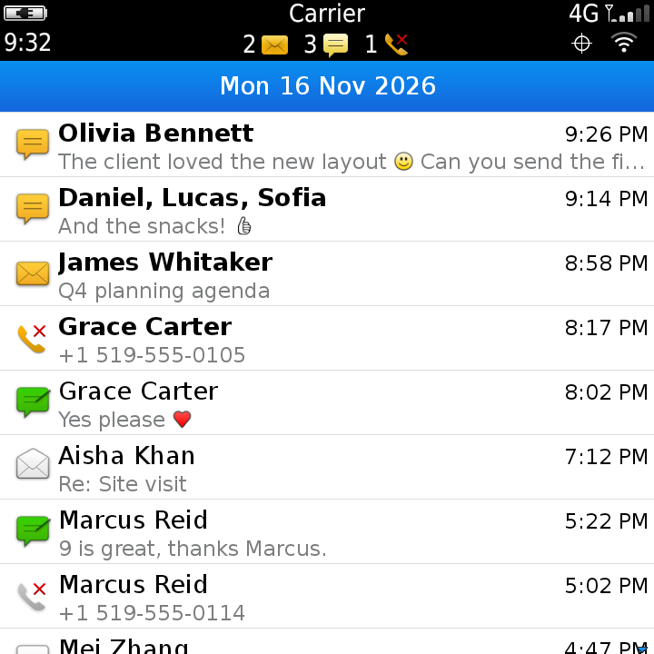<br><sub>Messages</sub></td>
    <td align="center">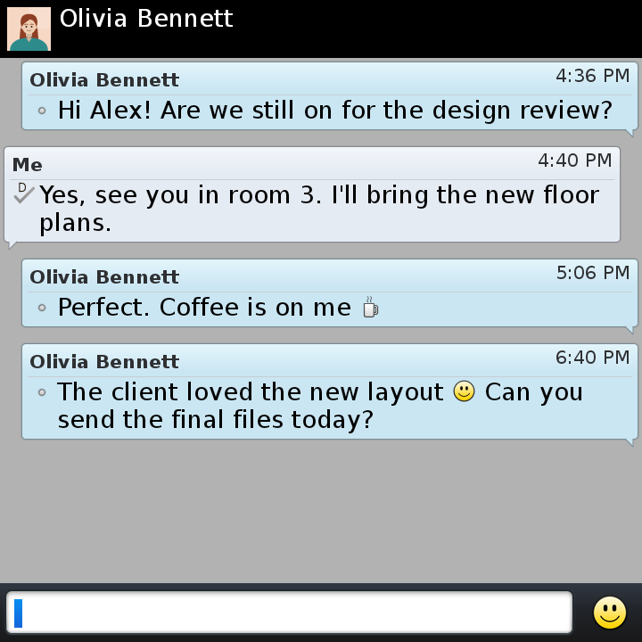<br><sub>Text conversation</sub></td>
    <td align="center"><br><sub>Phone</sub></td>
  </tr>
  <tr>
    <td align="center"><br><sub>Calendar</sub></td>
    <td align="center">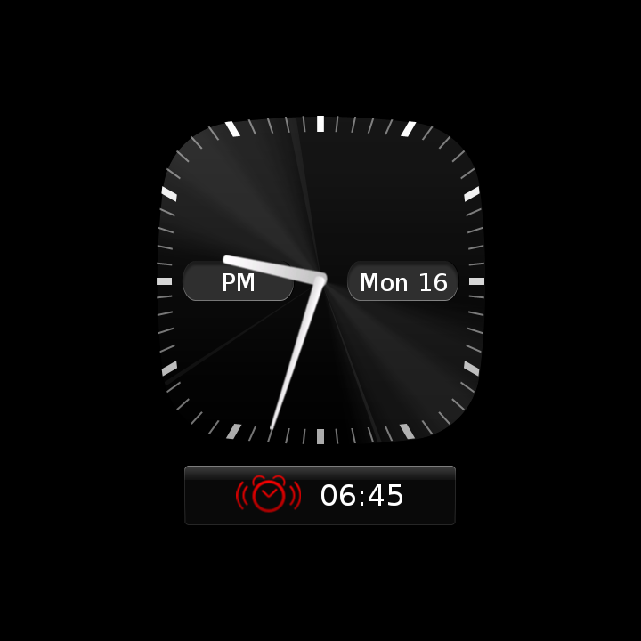<br><sub>Clock</sub></td>
    <td align="center">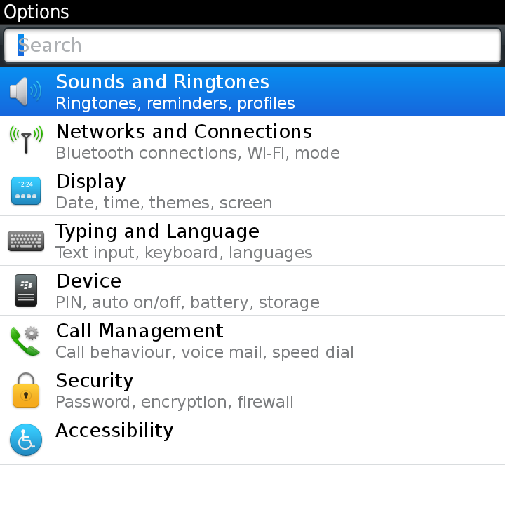<br><sub>Options</sub></td>
  </tr>
  <tr>
    <td align="center">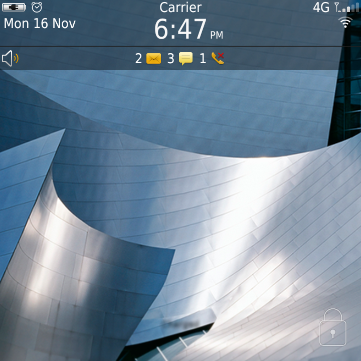<br><sub>Lock screen</sub></td>
    <td align="center">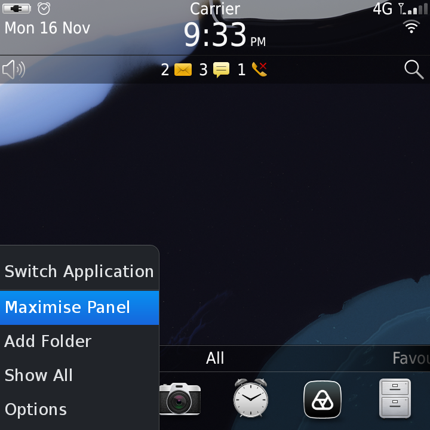<br><sub>Full menu</sub></td>
    <td align="center">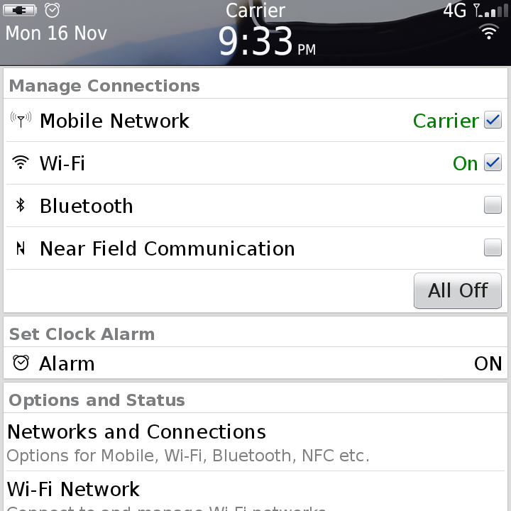<br><sub>Manage Connections</sub></td>
  </tr>
</table>

## Why

The Q25 has the keyboard and trackpad of a BlackBerry and the software of an Android phone. Bold7 gives it the software that keyboard was designed for. The goal is that the user forgets Android is underneath: every screen, label, sound, menu and animation that BlackBerry OS 7.1 had is done the way BlackBerry OS 7.1 did it, and everything that still shows Android is listed and tracked until it is replaced.

Bold7 is not a theme. It is a launcher, a set of apps, an input method, a SystemUI module and a KernelSU module that work together, close to a ROM, while leaving every partition of the phone untouched.

## Features

**Home screen**
- The OS 7 banner (clock, date, indicators, unread counters), wallpaper, and the drawer that rises over it.
- Drawer views Favourites, All, Frequent, Downloads and Media, folders, Move, Hide, Show All and Delete.
- Universal search by typing on the home screen, with the option to dial a number by typing it.
- App switcher on a long press of Menu, Switch Application at the top of every full menu.
- OS 7 icons and names for known apps; every other app gets its own icon in colour, lit and framed as third-party icons were on the 9900, or an older icon you provide yourself (see [Install](#install)). No raw Android icon is ever shown.
- Home Screen Preferences: the wallpaper, the Downloads Folder where new apps land, and which drawer views show.

**System**
- The two-line OS 7 status bar inside apps, with the theme's indicators, and the OS 7 charging bolt animated over the battery.
- The notification LED flashes as on the 9900: red for a new message or a ringing call, amber for a low battery, green for coverage when chosen in Options.
- Notification list dropping from the banner; Android's floating cards removed, except for calls, alarms and full-screen intents.
- Sound profiles: Normal, Loud, Medium, Vibrate Only, Silent, Phone Calls Only, All Alerts Off.
- Manage Connections, the volume window, the power-off dialog and shutdown screen, status messages in place of toasts.
- The OS 7 lock screen and password entry. Options, Security sets, changes and removes the device password in OS 7 boxes, with Lock After and Message on Lock Screen. Checking the code stays with Android (see [Device safety](#device-safety)).
- Help: the 9900's own help pages, decoded on the phone from your 9900 file, opened by H on the home screen or Help in every app's menu.
- Dialogs, menus, date and time pickers and choice lists of the Android framework restyled, so third-party apps follow.
- BBAlpha Sans as the system font, the 9900's other fonts as fallbacks, its colour palette, its transitions and its boot animation.
- Ringtones, notification and alarm sounds of the 9900's Normal profile; Android's interface sounds (charger, lock, touch) silenced as on the 9900.

**Apps**

| App | What it does |
|---|---|
| Messages | Unified inbox: text messages, email and app notifications. SMS, MMS and RCS threads drawn in OS 7 through the external API of Google Messages, which keeps the SMS role. Email over IMAP with push (IDLE), browser sign-in for Gmail and Outlook, per-account signatures, attachments, OS 7 emoticons. |
| Phone | Holds the dialer role: incoming, outgoing and in-call screens, call log, missed calls, contact search in the dial field. |
| Contacts | OS 7 contacts on Android's contacts provider. Nothing is copied. Answers other apps that ask for a contact. |
| Calendar | Day, Week, Month and Agenda views on Android's calendar provider. |
| Clock | Clock faces, alarm over the lock screen, bedside mode, stopwatch, timer. |
| Calculator, MemoPad, Tasks | As on the 9900. Tasks has reminders. |
| Pictures | Camera pictures, picture library and folders from the media store. |
| Options | The OS 7 options lists: sounds and profiles, display, typing, trackpad, Wi-Fi, date and time, device. |
| Camera | LineageOS 24: Bold7 Camera, a fork of BenOS Camera by Rudi Timmermans (GPL-3.0, source in [codexofc/bold7-camera](https://github.com/codexofc/bold7-camera) and attached to each release), driven from the keys and the trackpad. BenOS keeps its own BenOS Camera. |
| Help | The 9900's help, searchable, with a Bold7 section: removing Bold7, root, system updates. |
| Flashlight | A torch on the app grid. |

**Keyboard and trackpad**
- Typing, an input method for the physical keyboard with the OS 7 Direct and Predictive styles, word substitution, word learning, the Sym list, and selection, cut, copy and paste from the keyboard.
- The trackpad at OS 7 sensitivity in every app, with no pointer, and rejection of accidental thumb touches at the bottom of the screen.
- The End key returns to the home screen.

## Install

Pick the release of your system on the [releases page](https://github.com/codexofc/bold7/releases). Each zip checks the system it runs on and refuses the other one, and the KernelSU manager only ever offers updates of the line you installed.

| Your Q25 runs | Take | Status |
|---|---|---|
| **LineageOS 24** (official, Android 17) | `bold7-<version>-lineage24.zip` | recommended, developed first (`main` branch) |
| **BenOS** (Android 14) | `bold7-<version>-benos.zip` | kept up, with the fixes that apply to both (`benos` branch) |

**On LineageOS 24 you need** root with KernelSU Next as a kernel module (LKM: patch `boot`, not `init_boot`, with the KMI `android12-5.10`), NeoZygisk from the KernelSU Next manager, and Google apps (MindTheGapps) for Google Messages. Each weekly LineageOS update removes root: before rebooting into it, use the KernelSU Next manager's "Install to inactive slot (after OTA)".

**On BenOS you need** the KernelSU manager that BenOS ships, with its modules as they are.

**On both**, no metamodule, about 600 MB free, and the official BlackBerry Bold 9900 OS 7.1 file. Bold7 contains no BlackBerry asset: it reads this file on your phone and extracts what it needs there. Bold7 does not link to copies of it, and accepts either of these, recognised by size and SHA-256, placed as is (not renamed, not unzipped) in the phone's `Download` folder:

| File | Size (bytes) | SHA-256 |
|---|---|---|
| `9900M_PBr7.1.0_rel2807_PL5.1.0.692_A7.1.0.1033_Wind.exe` (Bold 9900 OS Loader, OS 7.1.0.1033) | 273797496 | `4f68dd201def6f3f5c648ce166e7e0e5ff713c79f55f97cb777b8aafa8b85adb` |
| `BlackBerry Simulator_7.1.0.318_9900.exe` (BlackBerry Simulator 7.1.0.318 for the 9900) | 240527751 | `79208dc1036487b05a1be007063bc377a649f4d9a973e58bade2ac06878474f1` |

**Need help finding the official 9900 file?** Contact the maintainer for advice by email at arthur@sw3rm.com or on Discord (username `_codexofc`).

1. **Download two files** into `Download/`: the zip of your system from the releases page, and the official 9900 file.
2. **Install the zip** from the KernelSU manager: Modules, Install, choose the zip. The manager shows each step: device and system recognised, 9900 file found and extracted, apps installed. If the 9900 file is missing, the installer stops before changing anything and says which file to place where.
3. **Reboot** with the button the manager shows.

**Optional: icons of your own.** Bold7 never ships icons of other apps. If you have older icons for some of your apps, put a folder `Bold7-icons/` of `<package name>.png` files (PNG, 1 MB at most each), or a zip holding it, in `Download/` before installing: the installer copies them to `Bold7/icons/` on your storage, where the home screen reads them in place of the generated ones, and where you can add more later. Removing Bold7 leaves that folder alone.

At first boot Bold7 sets itself as home screen, phone app and input method, grants its permissions and applies the OS 7 sounds and silences (on LineageOS 24 it also sets the density to 208, so that one pixel of the 9900 is one pixel of the Q25). On the first unlock a single screen asks the one thing nobody can decide for you: whether Bold7 may read and send your texts through Google Messages. If you decline, texts open in Google Messages. An email account is optional, from Messages, whenever you want.

### Update

The KernelSU manager offers new versions by itself. One tap installs them; the resources already extracted are kept. Each release zip is signed with Ed25519, and the public key is in the repository (`system/module/release/bold7-release.pub`):

```sh
openssl pkeyutl -verify -pubin -rawin -inkey bold7-release.pub -in bold7-<version>-<line>.zip -sigfile bold7-<version>-<line>.zip.sig
```

### Uninstall

KernelSU manager, Bold7, Remove, then reboot. Everything Bold7 changed is given back: home screen, phone app, input method, settings, sounds, and on LineageOS 24 the density. If the phone ever fails to boot with Bold7, press Volume down repeatedly during boot to start KernelSU's safe mode, which disables every module.

## Performance

Fluidity is the first goal. Every change on a hot path (home screen, transitions, lists, typing) is measured before and after on the Q25 itself, never on an emulator, with `tools/perf.sh`. The Q25 has a 60 Hz screen, so one frame lasts 16.6 ms.

<p align="center">
  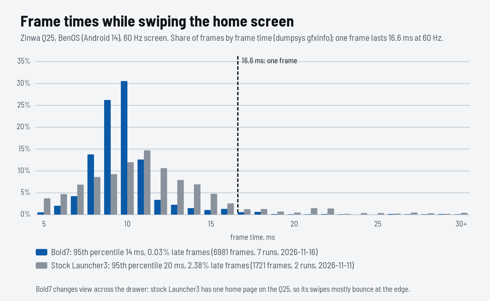
</p>

| Measure (`tools/perf.sh`) | Budget | Stock Launcher3 | Bold7 |
|---|---|---|---|
| Home view change by finger: late frames | < 1% | 2.38% * | 0.03% |
| Home view change by finger: 95th percentile | ≤ 16.6 ms | 20 ms * | 14 ms |
| Drawer raised and lowered: late frames, 95th percentile | < 1%, ≤ 16.6 ms | n/a | 0.50%, 18 ms |
| Drawer scrolled: late frames, 95th percentile | < 1%, ≤ 16.6 ms | n/a | 0.04%, 15 ms |
| Home screen at rest, 10 s | 0 frames | 0 frames | 0 frames in 5 runs, 1 frame in 2 |
| Launcher in background, 30 s of another app: CPU | ≤ 20 ms | 0 ms | 0 ms in 6 runs, 10 ms in 1 |
| Home screen memory (PSS) | ≤ 120 MB | 115.6 MB | 55.2 MB |
| Tap on an icon until the app starts | ≤ 120 ms | 125 ms | 110 ms |
| Tap on an icon until the app's first frame | ≤ 750 ms | not comparable † | 380 ms (Clock) |

Bold7: seven runs on November 16, 2026, release build. Stock Launcher3: two runs on November 11, 2026, on the same phone and the same BenOS build, before Bold7 was installed. The runs of each side are pooled: late frames over all frames, percentiles from the summed frame-time histograms, medians of every tap and of every run's memory.

\* Stock Launcher3 has a single home page on the Q25, so its swipes mostly measure the edge bounce, a lighter job than Bold7's change of view.
† Stock Launcher3's Calendar icon opens a relay activity, not the app itself.

The drawer's 95th percentile still crosses its budget in some runs (15 to 24 ms from one run to the next when it is raised and lowered). Traces show the main thread is never the cause: the slow frames wait for the GPU and for the compositor to give a buffer back. It is tracked as an open issue.

<p align="center">
  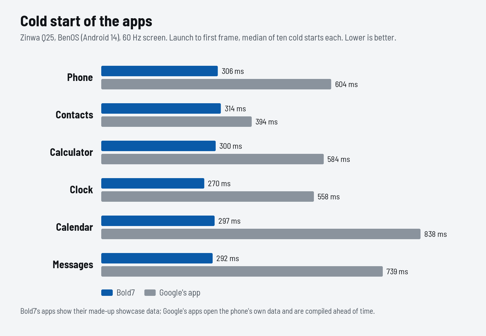
</p>

Each Bold7 app against the Google app it replaces, both installed on the same phone: ten cold starts each (`am start -W`, launch to first frame, after `am force-stop`), then the memory of the app at rest. Bold7's apps showed their made-up showcase data, and five of the six were not yet compiled ahead of time (only Clock was); Google's apps opened the phone's own data and were compiled from their profiles. Nothing on Google's screens was recorded, only the time.

<p align="center">
  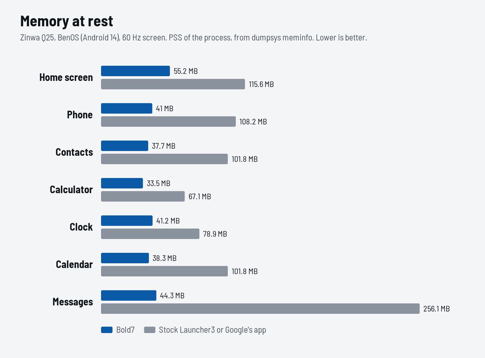
</p>

What each scenario does:

- **View change**: 20 round trips of a finger swipe across the drawer views, `dumpsys gfxinfo` reset before.
- **Drawer**: ten raises and lowers of the drawer, then ten scrolls of the unfolded All view.
- **At rest**: home screen shown for 10 s without input; any frame drawn is a failure.
- **Background**: Android Settings scrolled for 30 s; CPU time and context switches of every launcher thread.
- **Tap**: icon found by `uiautomator`, target app stopped, tap, then the `START` and `Displayed` timestamps of logcat; five cold runs. The `cmd input` injection adds about 70 ms for every launcher alike.
- **Memory**: `TOTAL PSS` of `dumpsys meminfo`, home screen shown. It depends on what the process did before (Options lives in the launcher's process): a fresh launcher measures 52 MB.
- **Apps**: `APP=<package>/<activity> tools/perf.sh` measures cold start with `am start -W` ten times.

`tools/bench.py` turns the raw runs into `media/demo/data/bench.json` and draws these charts from it.

## For developers

### Documentation

- [docs/BBOS7-VISUEL.md](docs/BBOS7-VISUEL.md): what the 9900 shows and plays, element by element, with its source and its square-screen layout. The code cites it by section (`§18`).
- [docs/ARCHITECTURE.md](docs/ARCHITECTURE.md): the code architecture and the testing rules.
- [docs/DEVICE.md](docs/DEVICE.md): facts measured on the Q25 and BenOS (root, mounts, SystemUI, input devices, trackpad).
- [docs/PERF.md](docs/PERF.md) and [docs/BASELINE.md](docs/BASELINE.md): the performance work, its traces, and the stock baseline the budgets come from.

### Architecture

```
core/        shared libraries, never depend on apps/ or system/
  design/      OS 7 design tokens (colours, BBAlpha typography, dimensions, curves), pure Kotlin
  theme/       OS 7 images read at runtime by name from the extracted resources
  ui/          OS 7 components as views: screen stack, full and short menus, stacked-button
               dialogs, focus lists, title bar, check boxes, spin dialogs
  icons/       package-to-icon and name tables, the generated-icon template
  firmware/    the 9900 file extractor (InstallShield, MSI, cabinet, .cod), pure Kotlin and JDK
  platform/    the only module that touches hidden APIs, device stubs and quickstep AIDL
  hub-data/    the unified inbox database (Room) and its provider
  mail/        IMAP and SMTP from Thunderbird for Android, used as source
apps/        one APK per app, each in its own process
  launcher/    home screen, drawer, search, app switcher, Options, recents provider
  hub/         the unified inbox engine (notification listener, SMS, call log, email)
  messages/ phone/ contacts/ calendar/ clock/ calculator/ memopad/ tasks/ pictures/ flashlight/
  saisie/      Typing, the input method for the physical keyboard
system/
  sysui/       hooks in SystemUI, loaded by Vector (libxposed API)
  overlays/    runtime resource overlays: framework, SystemUI, Settings, PermissionController,
               BlackBerry keyboard, recents component, app names
  module/      the KernelSU module: boot scripts, privileged permission list, sounds,
               boot animation, the native trackpad daemon
tools/       build, install, measurement and extraction scripts; essai/, a test app
```

The rules the code follows:

- **No Compose, anywhere.** Classic Android views in the launcher, SystemUI and every app. Each OS 7 component is written once, in `core/ui`, and shared.
- **The main thread only renders.** I/O, PackageManager, database, heavy binder calls and image decoding run on injected dispatchers. StrictMode crashes debug builds on any violation.
- **Animations never wait on a busy thread.** What follows the finger ends on a critically damped spring that keeps the release velocity; windows move with `SurfaceControl` transactions on a dedicated thread.
- **Pure Kotlin core, Android at the edge.** Logic that decides (parsing, state, focus, scrolling, MIME) imports nothing from `android.*`. Screens hold an immutable state, events and a pure reducer, tested on the JVM. Each system service sits behind a narrow interface with a hand-written fake. No mocking library, no dependency injection framework.
- **Overlays first, hooks second.** A resource overlay is used whenever a resource is enough. SystemUI hooks are only for what overlays cannot reach. On BenOS they target its exact SystemUI, check its APK fingerprint at startup and switch themselves off if it changes. On LineageOS 24, which updates every week, each group of hooks checks its own targets at startup and switches itself off when one has moved, leaving that part to Android. A hook that fails is counted and visible, never swallowed.
- **The module mounts its own files.** At install, `customize.sh` packs the module's files into an ext4 image; at boot, `post-fs-data.sh` mounts it read-only and lays one overlayfs per target directory over `/product` and `/system_ext`. All or nothing: one failed mount undoes the others and Android boots unchanged.
- **No gestures.** OS 7 had none. The launcher still registers as recents provider so that the stock launcher does not take the bottom edge back.
- **Kotlin, `minSdk = targetSdk = compileSdk = 37` on LineageOS 24 (`main`), `34` on BenOS (`benos`).** One device per line, no compatibility branches. Native code only where a measurement on the device shows a gain: today, the trackpad daemon in C.

### Build

Prerequisites:

- JDK 17 or newer, the Android SDK with build-tools (`aapt2`) and NDK `29.0.14206865`;
- `ffmpeg` with libopus and ImageMagick (`magick`) on the `PATH`;
- Python 3.10 or newer, with `pyexpat`;
- a Q25 on adb, once, to pull the compile stubs (read only);
- your own official 9900 file, to extract the resources the development build embeds.

```sh
# Compile stubs from the device: framework.jar and SystemUI, read only. Rerun after each system update.
# Build the branch of the system the phone runs: main for LineageOS 24, benos for BenOS.
tools/stubs.sh

# Extract the 9900 resources into assets-private/ (never committed), then generate assets-gen/.
python3 -I tools/extract-bbos7.py <official 9900 file>
tools/import-assets.sh telephone                   # the phone's original fonts.xml, read only
tools/import-assets.sh                             # or name blocks: tools/import-assets.sh polices ui

# Signing key, once per machine. Keep it: losing it means uninstalling the privileged apps to update them.
mkdir -p keys && pw=$(openssl rand -base64 33 | tr -d '/+=' | cut -c1-32)
keytool -genkeypair -keystore keys/bold7.jks -storetype PKCS12 -alias bold7 -keyalg RSA \
  -keysize 4096 -validity 36500 -dname "CN=Bold7" -storepass "$pw" -keypass "$pw"
printf 'sdk.dir=%s\nbold7.keystore.password=%s\n' "$ANDROID_HOME" "$pw" > local.properties
chmod 600 keys/bold7.jks local.properties

./gradlew assembleRelease                          # every APK
./gradlew :system:module:moduleZip                 # the KernelSU module zip
./gradlew assembleRelease -Pbold7.public=true      # public build: fails if any BlackBerry file is in an APK
```

Four blocks of `tools/import-assets.sh` still read sources the extractor does not produce yet: `clock`, `calendar` and `demarrage` cut a few images from captures of the official simulator (`assets-private/reference-bbos7/simulateur/`), and `saisie` reads the typing dictionaries (`assets-private/saisie/`). Until they move into `core/firmware`, these blocks stop and name the missing file. With only the 9900 file, run the other blocks by name, then the JVM tests without the three apps that need those sources:

```sh
tools/import-assets.sh polices accueil profils connexions options icones sons ui dialogues messages phone \
  contacts calculatrice memopad tasks pictures bandeau indicateurs systeme bb10 fonds
./gradlew test -x :apps:clock:test -x :apps:calendar:test -x :apps:saisie:test
```

The APKs of Clock, Calendar and Typing, and the module zip (which carries the boot animation of `demarrage`), need those sources too. `tools/stubs.sh` needs a Q25 on adb once; without `stubs/`, `core/platform` and everything that depends on it do not compile. The Python tests of `tools/` need Python 3.10 or newer with `pyexpat`.

The public build reads OS 7 images at runtime from the resources extracted on the phone, and checks every release APK against the hashes of the 9900 file and of `assets-gen/`, by bytes and by pixels.

Developers install on a connected Q25 with `tools/install.sh` and remove everything with `tools/uninstall.sh`. Both change the state of the phone, refuse to run on an unknown device state, and are documented at the top of each script.

### Test

```sh
./gradlew test                                     # JVM tests of every module, and the trackpad model in C
python3 -m unittest discover -s tools -p 'test_*.py'   # tests of the Python and shell tools
system/module/test-guard.sh                        # boot scripts replayed on the phone, in /data/local/tmp
APP=dev.bold7.pictures/.PicturesActivity tools/perf.sh pictures   # performance of one app
```

Non-trivial logic is written test first. Every decision in a boot script has a test that runs with the phone's own `sh` in `/data/local/tmp`, without installing the module or rebooting (`system/module/test-*.sh`). The module never ships without a full install and uninstall round trip, compared state by state with `tools/state.sh`.

### Fidelity

Every visible or audible element has a source, graded in the code next to it:

| Grade | Source |
|---|---|
| **F** | the 9900 OS 7.1 firmware: images, `.pme` layouts, fonts, sounds, theme values |
| **C** | a native capture of a real 9900 or of the official BlackBerry simulator |
| **M** | a manual or guide published by RIM |
| **S** | recollection or press; cross-checked before anything is drawn |
| **D** | deduced, in particular every layout recomputed for the square screen |

Nothing is invented, and an Android default is never a design choice. An element without a source is marked as eyeballed, never presented as OS 7.

**The square screen.** A 9900 pixel (640 x 480 at 287 ppi) and a Q25 pixel (720 x 720 at 295 ppi) have the same physical size within 2.7%. Firmware images are therefore never scaled: they are drawn pixel for pixel, and layouts are recomputed for 720 x 720 with more columns, margins or rows. Each square layout is graded D. A visual change is checked by a Q25 capture placed next to its reference capture.

### Device safety

The Q25 has no flashable recovery image, so Bold7 is built never to need one.

- **Nothing writes to a partition.** No `dd`, no `fastboot flash`, no write to `/system`, `/vendor`, `/product` or `/system_ext`. Every file arrives through the module's read-only mounts.
- **The module can always be removed**, from the KernelSU manager or by KernelSU's safe mode (Volume down repeated at boot). A boot-loop guard disables the module after repeated failed boots, and a SystemUI guard does the same if SystemUI crashes in a loop.
- **No `su` in any APK.** Privileges come from privileged-app status and a fixed, minimal permission list that the build checks line by line against the manifests.
- **The lock code is checked by Android.** Bold7 draws the OS 7 lock screen and passes the code straight to Android's own verification (Gatekeeper and the TEE), without copy, log or storage. Attempt counting, delays and wiping remain Android's.
- **Nothing interactive while locked**: no replies, no notification actions.
- **Exported components** are protected by a signature or system permission, or not exported.
- **No telemetry, no network request** the user did not ask for. Typing never logs a key or a word, and reads nothing in password fields.

### Contributing

Read [CONTRIBUTING.md](CONTRIBUTING.md). Security issues go through [SECURITY.md](SECURITY.md), not public issues.

## Legal

BlackBerry, BlackBerry OS and their visual and audio elements are the property of their respective owners. Bold7 is an independent project, not affiliated with or endorsed by BlackBerry Limited or Zinwa. Bold7 does not distribute any BlackBerry asset: each user provides their own official BlackBerry 9900 OS file, and Bold7 extracts the resources on their own phone.

The screenshots and the video on this page show the interface running with resources extracted that way.

## License

Bold7 is licensed under the [Apache License 2.0](LICENSE). Third-party code in the repository and its licences are listed in [NOTICE](NOTICE). BlackBerry assets are never part of the repository and are not covered by this licence.

## Acknowledgements

- The [Android Open Source Project](https://source.android.com), for the quickstep interfaces Bold7 builds on.
- [Thunderbird for Android](https://github.com/thunderbird/thunderbird-android) (formerly K-9 Mail), whose mail protocol layer Bold7 uses.
- [KernelSU](https://kernelsu.org) and KernelSU Next, which make a removable system module possible.
- [Vector](https://github.com/JingMatrix/LSPosed), the maintained LSPosed fork, and the libxposed API.
- [BenOS Camera](https://github.com/ruditimmermans/BenOSCamera) by Rudi Timmermans, which Bold7 Camera is forked from.
- [LineageOS](https://lineageos.org) and its maintainers of the Q25, and the BenOS ROM, the two systems Bold7 runs on.
- [The Barlow Project](https://github.com/jpt/barlow), for the typeface of the Bold7 wordmark.
- Everyone who kept BlackBerry OS documentation, simulators and captures available.
